# SAC — Modèle global des données et cohérence des domaines

Date : 18 novembre 2026  
Statut : consolidation de conception ; modèle logique non validé comme schéma SQL et non implémenté.  
Base cible : Cloudflare D1 `sac-db` (base métier actuellement documentée comme vide).  
Branche de référence : `main`.

## 1. Objet et hiérarchie documentaire

Ce document réunit le modèle citoyen, les services transversaux et le modèle administratif en un référentiel logique unique. Il ne remplace pas les contrats spécialisés ; il les relie et tranche les conventions de vocabulaire lorsqu'ils décrivent la même donnée.

Références à lire avec ce document :
- `SCHEMA_RELATIONNEL_D1_PROPOSITION.md` : première proposition de tables ;
- `REVUE_SCHEMA_RELATIONNEL_D1.md` : revue critique et blocages structurels ;
- `MATRICE_TRACABILITE_SCHEMA_D1.md` : contraintes, tests et conservation table par table ;
- `MACHINES_ETATS_ET_CONSERVATION.md` : états et transitions métier ;
- `CONTRATS_OPERATIONS_ATOMIQUES_D1.md` et `CONTRATS_OPERATIONS_ADMIN_ATOMIQUES.md` : opérations serveur ;
- `MODELE_DONNEES_ADMIN_ET_INTEGRATION_SAC.md` : détail administratif ;
- `DECISIONS_PRODUIT_RESTANTES.md` et `ARBITRAGES_CONTACT_REVOQUE_ET_ALERTE_ORPHELINE.md` : décisions non encore tranchées ;
- `DECISION_NOTIFICATIONS_PUSH_ET_ESCALADE_SMS.md` : seuil push/SMS validé.

**Règle de priorité :** les décisions expressément validées par le porteur priment sur les formulations historiques des documents de conception. Une proposition technique ou une recommandation n'est pas une décision produit. Les contrats et le code existants ne prouvent pas qu'une fonction est déployée.

## 2. Conventions canoniques

### 2.1 Identité unique

Le modèle D1 initial utilise le terme `accounts` pour le compte citoyen. Le modèle administratif précédent emploie parfois `users`. Pour éviter deux identités ou deux tables maîtresses, **`accounts` devient le nom conceptuel canonique** dans le modèle global.

- Chaque personne possède un seul compte SAC.
- Une personne peut être citoyenne, contact de confiance et collaborateur administratif à des moments différents, sans créer un compte distinct pour chaque fonction.
- Les fonctions professionnelles sont des profils/affectations liés au même identifiant de compte, avec authentification et politiques propres.
- Les documents administratifs qui parlent de `users` doivent être lus comme faisant référence à `accounts`, sauf décision ultérieure explicitement documentée.
- Les rôles administratifs, permissions, missions et sessions professionnelles restent distincts des relations de confiance citoyennes.

### 2.2 Vocabulaire à ne pas confondre

| Notion | Signification |
|---|---|
| Compte | Identité SAC et cycle de vie de la personne |
| Identité de contact | Adresse e-mail ou numéro de téléphone associé au compte, avec preuve de vérification propre |
| Appareil | Terminal enregistré et ses clés publiques/certificats |
| Session | Autorisation temporaire liée à un compte et à un appareil |
| Relation de confiance | Lien directionnel entre deux comptes après invitation et acceptation |
| Groupe | Organisation privée de membres ; ne donne aucun droit d'accès par lui-même |
| Destinataire | Compte figé dans l'instantané d'une alerte ou d'un trajet |
| Réponse | Accusé, volontariat ou retrait d'un destinataire |
| Responsable principal | Contact effectivement désigné par le serveur pour la prise en charge |
| Permission | Action atomique autorisée |
| Mission | Délégation explicite, limitée dans le temps et dans son périmètre |
| Notification | Tentative de communication ; ne prouve pas la lecture ni la prise en charge |
| Abonnement | Droit commercial calculé côté serveur |
| Paiement | Opération financière vérifiée par preuve du prestataire |

## 3. Carte globale des domaines

Le modèle est organisé en domaines reliés par des identifiants et des événements, mais avec des responsabilités séparées :

1. **Identité et sécurité du compte** : comptes, identités, défis OTP, récupération, appareils, certificats, sessions.
2. **Réseau de confiance** : invitations, relations directionnelles, préférences, groupes et membres.
3. **Alertes SOS** : alertes, destinataires figés, chronologie, réponses, responsabilités et règles de clôture.
4. **Protection des trajets** : trajets, participants, consentements, contrôles d'arrivée et échéances.
5. **Programmation et SOS discret** : alertes programmées et configuration sécurisée du mécanisme de contrainte.
6. **Communication** : abonnements push, outbox, rappels, escalade SMS et tentatives de livraison.
7. **Offres et paiements** : catalogue de formules, abonnements, tentatives/transactions, événements de prestataire et droits Premium.
8. **Administration et gouvernance** : affectations de rôle, missions, permissions, dossiers d'accès, décisions administratives et audit.
9. **Conservation et conformité** : politiques de rétention, demandes de suppression, anonymisation, exports et preuves de purge.

Les services professionnels (RH, comptabilité, logistique, secrétariat, juridique, relations externes) constituent un domaine organisationnel séparé. Ils ne doivent pas être fusionnés avec les données de sécurité des citoyens ; leurs objets et permissions doivent être reliés au compte du collaborateur et aux missions appropriées.

## 4. Catalogue logique global

Les noms sont indicatifs. Une entité marquée « à ajouter à la proposition » n'existe pas encore dans la première proposition de schéma. Aucun nom ne constitue une autorisation de créer une table.

### 4.1 Comptes, identités et sécurité

| Entité canonique | Fonction | Relations principales | État |
|---|---|---|---|
| `accounts` | Compte et cycle de vie | parent des identités, appareils, sessions, relations, alertes, trajets | proposée |
| `account_identities` | Téléphone/e-mail normalisé et preuve de vérification | N:1 compte | proposée |
| `auth_challenges` | OTP/défis à usage unique, finalité, essais, expiration, consommation | compte/identité | proposée |
| `account_recovery_events` | Historique minimal de récupération et remplacement du kit unique | compte, appareil/événement | à détailler |
| `user_devices` | Appareils et version d'autorisation | N:1 compte | proposée |
| `device_certificates` | Certificats publics liés au compte/appareil | N:1 appareil | proposée |
| `device_pairing_challenges` | Défis de jumelage à usage unique | compte, appareil racine, appareil en attente | proposée |
| `device_sessions` | Sessions par appareil, hash du jeton, expiration et révocation | compte + appareil | proposée |

Règles validées :
- adresse e-mail obligatoire dès l'inscription ; aucun compte sans e-mail ni inscription par téléphone seul ; activation uniquement après vérification de cette adresse par OTP e-mail valide (condition sine qua non) ; OTP e-mail également utilisé pour les opérations sensibles/réinitialisations ; aucun OTP SMS de compte ;
- mot de passe minimum 12 caractères ; les passphrases, espaces et Unicode sont admis ; ne pas tronquer les valeurs longues ;
- téléphone obligatoire à l'inscription avec indicatif international, mais déclaré et non vérifié indépendamment ;
- 30 jours consécutifs d'inactivité entraînent une déconnexion ; réauthentification obligatoire au plus tard à 90 jours même en cas d'activité ;
- le kit personnel de récupération est généré localement, montré une seule fois et à usage unique ; il restaure l'accès au compte, pas l'identité cryptographique racine ;
- un seul appareil racine approuve les appareils secondaires en V1 ; les appareils secondaires ne délèguent pas leur approbation ;
- une suspension bloque les nouvelles activités et révoque les sessions selon la politique, sans effacer les alertes déjà transmises.

Le cycle de vie compte validé comprend cinq états : `pending_verification`, `active`, `suspended`, `deletion_pending`, `deleted`. Toute inscription exige une adresse e-mail ; la vérification de cette adresse par OTP est une condition sine qua non du passage à `active`. Sans e-mail vérifié, le compte reste `pending_verification`, sans session ni accès privé. Le téléphone obligatoire ne remplace jamais cette exigence. La vérification e-mail est un fait séparé de l'état. La suspension administrative est réservée à l'autorité habilitée ; elle est distincte d'un verrouillage technique temporaire.

### 4.2 Proches, invitations, préférences et groupes

| Entité canonique | Fonction | Relations principales | État |
|---|---|---|---|
| `contact_invitations` | Invitation, destinataire, jeton hashé, échéance et acceptation | compte propriétaire, identité de destination, compte accepté | proposée |
| `trusted_contacts` | Relation directionnelle propriétaire → proche | deux comptes, invitation acceptée | proposée |
| `contact_alert_preferences` | Préférences par catégorie | relation de confiance | proposée |
| `groups` | Groupe privé créé par un compte | propriétaire | à ajouter |
| `group_members` | Adhésions, état et rôle organisationnel limité | groupe + compte | à ajouter |
| `group_invitations` | Invitation et consentement d'adhésion à un groupe | groupe + compte/identité | à définir |

Règles :
- invitation en attente = aucun accès ;
- relation de confiance directionnelle : A choisit B, sans droit réciproque implicite ;
- l'acceptation et la vérification du moyen de contact utilisé doivent être établies côté serveur ;
- un groupe sert à organiser les proches ; appartenance à un groupe ne donne jamais accès à l'alerte, au compte ou au GPS ;
- la sélection des destinataires d'une alerte est toujours explicite et validée par le serveur ;
- les limites de l'offre s'appliquent au nombre de proches autorisés.

**Règle désormais établie :** tout proche qui devient un contact SAC actif doit disposer d'un compte SAC actif avec adresse e-mail vérifiée par OTP ; téléphone seul et SMS ne suffisent jamais. Le parcours de bout en bout, les entités logiques, les états et les tests sont détaillés dans `CONTRAT_CYCLE_VIE_PROCHES_ET_INVITATIONS.md`. Les durées, relances, fournisseur, révocation symétrique et droits après révocation pendant une alerte restent à arbitrer. Aucun SMS OTP ne doit être ajouté.

Les groupes privés figurent au cahier des charges, mais ils ne figurent pas dans la première proposition relationnelle D1. Leur cardinalité, limites, invitations, retrait, rôle de gestion et règles de suppression restent à spécifier. Aucun droit d'alerte ne doit être hérité d'un groupe.

### 4.3 Alertes, destinataires et prise en charge

| Entité canonique | Fonction | Relations principales | État |
|---|---|---|---|
| `alerts` | Alerte créée par un compte, catégorie, niveau, seuil de rappel, état et dates | N:1 auteur | proposée |
| `alert_recipients` | Instantané immuable des destinataires | alerte + compte + relation ayant autorisé la sélection | proposée |
| `alert_events` | Chronologie métier append-only | alerte, acteur compte/système/administrateur selon événement | proposée |
| `alert_responses` | Accusé, candidature, retrait | alerte + destinataire | proposée |
| `alert_responsibility_history` | Historique des responsables principaux successifs | alerte + compte destinataire | proposée |
| `alert_recipient_permissions` | Droits séparés après révocation | alerte + destinataire | conditionnelle, arbitrage requis |

Catégories métier : danger personnel, accident, intrusion au domicile, urgence médicale, personne perdue/désorientée, alerte personnalisée. Niveaux : préventif, urgent, critique.

Invariants :
- destinataires vérifiés et figés dans la même opération que la création de l'alerte ;
- aucun destinataire ajouté automatiquement ;
- accusé de réception ≠ prise en charge ;
- volontariat ≠ responsabilité principale ;
- un seul responsable principal actif à la fois ;
- la première prise en charge effective est arbitrée par l'ordre serveur et une opération atomique ;
- retrait du responsable courant : transfert au prochain volontaire éligible selon l'ordre validé ; sinon aucun responsable n'est affiché ;
- aucun contact ne clôture l'alerte de l'auteur ;
- les rappels continuent toutes les cinq minutes vers les destinataires initiaux jusqu'à la clôture par l'auteur ; prise en charge et accusé n'arrêtent pas ces rappels.

#### Clôture et exception administrative

La règle générale reste la clôture par l'auteur. Une exception étroite est validée pour le scénario du titulaire suspendu et d'une suspicion d'abus/perte de téléphone : seul le Super Admin ou l'Administrateur sécurité muni de la permission nominative dédiée peut clôturer après vérification. Les contacts peuvent signaler la fin du danger et demander une clôture, mais ne la décident pas. Un seul administrateur habilité suffit. Le silence n'est jamais une preuve de sécurité. Cette exception ne devient pas un droit général de clôture administrative.

### 4.4 Notifications, push, SMS et rappels

| Entité canonique | Fonction | Relations principales | État |
|---|---|---|---|
| `push_subscriptions` | Abonnement push lié à un appareil | compte + appareil | proposée |
| `notification_outbox` | Tâches initiales, rappels et SMS d'escalade | alerte/trajet/événement + destinataire + canal | proposée |
| `notification_attempts` | Tentatives et réponses du fournisseur | tâche outbox | proposée |
| `notification_preferences` | Préférences de canal et de réception non urgentes | compte/appareil | à détailler |
| `scheduled_jobs` ou mécanisme équivalent | Échéances et reprises durables | objet métier + clé d'idempotence | mécanisme à choisir |

Règles validées pour SOS :
- push = canal normal et prioritaire ;
- le push initial ne compte pas comme rappel ;
- rappels push toutes les cinq minutes ;
- le lanceur choisit de 1 à 5 rappels avant escalade SMS ; valeur présélectionnée : 2 rappels, soit 10 minutes ;
- au seuil, SMS seulement si aucun responsable principal n'est effectivement attribué ;
- si un responsable principal est attribué avant la création des tâches SMS, l'escalade est annulée ;
- SMS adressé uniquement aux destinataires initiaux ;
- après escalade, les rappels push continuent jusqu'à clôture par l'auteur ;
- les tâches non envoyées sont annulées à la clôture ; une livraison déjà acceptée par un fournisseur peut encore arriver.

Le modèle doit donc enregistrer le seuil choisi par alerte, le numéro d'occurrence de rappel, le canal, la clé de déduplication, les baux worker, le compteur d'essais, l'échéance suivante et l'état d'escalade. Le statut « accepté par le fournisseur » n'est ni « livré » ni « lu ».

### 4.5 Protection des trajets

| Entité canonique | Fonction | Relations principales | État |
|---|---|---|---|
| `trips` | Trajet, auteur, mode, destination textuelle, heure estimée et état | N:1 auteur | proposée |
| `trip_participants` | Destinataires explicitement sélectionnés | trajet + compte | proposée |
| `arrival_checks` | Échéance, délai de grâce choisi, confirmation/absence | trajet | proposée |
| `trip_events` | Chronologie de trajet si non couverte par événements génériques | trajet + acteur | à arbitrer |
| `trip_sharing_sessions` | Consentement, durée, destinataires et état du partage sans coordonnées | trajet + compte/participant | à préciser hors D1 GPS |

Trois modes :
- `arrival_check` : vérification d'arrivée ;
- `accompaniment` : accompagnement ;
- `full_protection` : protection complète.

La confirmation d'arrivée appartient à l'auteur. Une arrivée non confirmée est un signal de retard, jamais une preuve d'accident. Les relances et délais sont configurés et vérifiés côté serveur.

**GPS :** aucune table de coordonnées précises, géohash, payload GPS ou clé de déchiffrement ne doit être créée dans D1/R2 ou les logs. L'exigence J+30 impose une impossibilité réelle de restauration et de lecture après échéance ; elle n'est pas satisfaite par une suppression SQL. La proposition de transport sans persistance serveur, de clés locales et de relais éphémère reste à prototyper et à faire auditer. GPS reste NO-GO.

### 4.6 Alertes programmées et SOS discret

| Entité canonique | Fonction | Relations principales | État |
|---|---|---|---|
| `scheduled_alerts` | Déclenchement futur, paramètres validés, destinataires à revalider à l'échéance selon règle à définir | compte auteur | à ajouter |
| `scheduled_alert_events` | Création, modification, annulation, déclenchement ou échec | alerte programmée | à ajouter |
| `duress_credentials` | Vérificateur protégé du code de contrainte, version, état et anti-abus | compte + appareil selon parcours | à ajouter |
| `duress_events` | Événement de déclenchement discret minimisé | compte/appareil + alerte résultante | à définir |

Le code de contrainte ne doit jamais être stocké en clair. Il faut définir le hachage adapté à un secret humain, la limitation d'essais, les scénarios hors ligne et la liaison aux appareils. L'écran neutre après déclenchement est une règle d'interface, pas une entité D1.

Les alertes programmées sont distinctes des alertes déjà déclenchées. L'annulation avant l'échéance empêche le déclenchement ; après création effective d'une alerte, la clôture suit la règle SOS ordinaire. Les comportements en cas de compte suspendu, suppression en attente, absence de réseau ou changement des proches doivent être définis avant API.

### 4.7 Offres, abonnements et paiements

| Entité canonique | Fonction | Relations principales | État |
|---|---|---|---|
| `plans` | Catalogue versionné des offres et limites | aucune ou version | à ajouter |
| `subscriptions` | Souscription, période, état, formule et compte | N:1 compte, plan | hors première proposition |
| `payment_transactions` | Tentatives/transactions, montant FCFA, fournisseur, référence, état | N:1 compte + abonnement | hors première proposition |
| `payment_provider_events` | Webhooks/notifications du prestataire dédupliqués | transaction | à ajouter |
| `subscription_events` | Activation, renouvellement, expiration, échec, remboursement, changement | abonnement | à ajouter |
| `account_entitlements` ou calcul serveur | Droits effectifs et limites au moment d'une action | compte + abonnement | mécanisme à arbitrer |

Règles produit existantes :
- offre gratuite : maximum 2 contacts ;
- offre Premium : maximum 10 contacts ;
- prix de référence Premium : 5 000 FCFA par mois ;
- avantages Premium autres que la limite de contacts : liste définitive à confirmer ;
- le client ne peut jamais s'attribuer Premium ;
- l'activation dépend d'une preuve serveur du prestataire, pas d'une capture d'écran ou d'un retour navigateur.

Le fournisseur Mobile Money/paiement, les renouvellements automatiques ou manuels, les délais de grâce, remboursements, prorata, échecs et rapprochements ne sont pas arrêtés. Les tables de paiement sont absentes de la première proposition D1 ; elles devront faire l'objet d'un sous-modèle et d'une revue de sécurité financière avant migration.

### 4.8 Administration et console professionnelle

Les entités détaillées dans `MODELE_DONNEES_ADMIN_ET_INTEGRATION_SAC.md` sont intégrées au modèle global et doivent référencer `accounts` comme identité canonique, pas créer une seconde table d'identité `users`.

Domaines :
- rôles et affectations administratives ;
- catalogue de permissions atomiques ;
- missions et permissions de mission ;
- portée de mission ;
- sessions professionnelles ;
- dossiers d'accès exceptionnel ;
- dossiers de vérification et décisions de clôture administrative ;
- demandes d'export et livraisons ;
- événements d'audit append-only et contrôles d'intégrité.

Le Super Admin seul gère les missions et délégations. Les délégataires ne peuvent ni déléguer ni étendre leurs droits. L'accès console est réservé aux ordinateurs/tablettes selon les contrôles serveur prévus ; l'application citoyenne reste l'expérience mobile.

Les services RH, comptabilité, logistique, secrétariat, juridique, documents et relations externes sont un sous-domaine organisationnel séparé. Leurs modèles détaillés doivent rester dans les annexes métier professionnelles ; aucun droit sur les alertes citoyennes ne découle d'une fonction RH, financière ou logistique.

## 5. Carte de relations et cardinalités

La vue suivante est conceptuelle ; elle n'implique aucune création de table.

```mermaid
erDiagram
  ACCOUNTS ||--o{ ACCOUNT_IDENTITIES : possede
  ACCOUNTS ||--o{ AUTH_CHALLENGES : valide
  ACCOUNTS ||--o{ USER_DEVICES : enregistre
  USER_DEVICES ||--o{ DEVICE_CERTIFICATES : porte
  USER_DEVICES ||--o{ DEVICE_SESSIONS : ouvre
  USER_DEVICES ||--o{ PUSH_SUBSCRIPTIONS : recoit
  ACCOUNTS ||--o{ CONTACT_INVITATIONS : envoie
  ACCOUNTS ||--o{ TRUSTED_CONTACTS : proprietaire
  ACCOUNTS ||--o{ TRUSTED_CONTACTS : proche
  TRUSTED_CONTACTS ||--o{ CONTACT_ALERT_PREFERENCES : configure
  ACCOUNTS ||--o{ GROUPS : cree
  GROUPS ||--o{ GROUP_MEMBERS : contient
  ACCOUNTS ||--o{ GROUP_MEMBERS : rejoint
  ACCOUNTS ||--o{ ALERTS : declenche
  ALERTS ||--|{ ALERT_RECIPIENTS : fige
  ALERTS ||--o{ ALERT_EVENTS : historise
  ALERTS ||--o{ ALERT_RESPONSES : recoit
  ALERTS ||--o{ ALERT_RESPONSIBILITY_HISTORY : attribue
  ALERTS ||--o{ NOTIFICATION_OUTBOX : notifie
  NOTIFICATION_OUTBOX ||--o{ NOTIFICATION_ATTEMPTS : tente
  ACCOUNTS ||--o{ TRIPS : planifie
  TRIPS ||--o{ TRIP_PARTICIPANTS : associe
  TRIPS ||--o{ ARRIVAL_CHECKS : controle
  ACCOUNTS ||--o{ SCHEDULED_ALERTS : programme
  ACCOUNTS ||--o{ SUBSCRIPTIONS : souscrit
  SUBSCRIPTIONS ||--o{ PAYMENT_TRANSACTIONS : regle
  PAYMENT_TRANSACTIONS ||--o{ PAYMENT_PROVIDER_EVENTS : confirme
  ACCOUNTS ||--o{ ADMIN_ROLE_ASSIGNMENTS : recoit
  ACCOUNTS ||--o{ ADMIN_MISSIONS : beneficie
  ADMIN_MISSIONS ||--o{ ADMIN_MISSION_PERMISSIONS : autorise
  ADMIN_MISSIONS ||--o{ ADMIN_AUDIT_EVENTS : trace
```

Une table générique d'événements peut être utilisée uniquement si elle conserve une typologie, un propriétaire, des contraintes de référence et des politiques d'accès suffisamment fortes. Il ne faut pas créer un sac JSON universel qui mélangerait alertes, sécurité, paiements et audit.

## 6. Invariants transverses et intégrité relationnelle

1. Identifiants opaques et générés côté serveur.
2. Horodatages serveur UTC ; l'heure client n'est jamais l'autorité pour l'ordre ou l'expiration.
3. Clés étrangères composites pour garantir le même compte entre session/appareil/certificat, le même propriétaire sur invitation/relation, et l'appartenance à l'instantané pour les réponses.
4. Interdiction des relations auto-référentes et doublons là où la règle métier l'exige.
5. Les destinataires d'une alerte sont différents de son auteur.
6. Une seule responsabilité principale non terminée par alerte.
7. Une seule consommation réussie d'un défi ou d'une commande à usage unique.
8. Clés d'idempotence uniques pour déclenchements, rappels, escalades, paiements et webhooks.
9. Les suppressions en cascade ne doivent pas effacer les alertes, décisions, événements ou audits à conserver.
10. Les permissions sont contrôlées à chaque lecture et dans l'écriture finale ; masquer un bouton n'est pas une autorisation.
11. L'outbox n'est pas la source de vérité métier ; un échec d'envoi ne clôture ni ne supprime une alerte.
12. Une réponse fournisseur « acceptée » ne signifie pas « livrée » ; la livraison ne signifie pas « lue ».
13. Les exports, caches, analytics, journaux et sauvegardes doivent suivre les mêmes classes de sensibilité et règles de conservation que la donnée source.
14. Les métadonnées JSON doivent être validées par liste blanche ; aucune donnée secrète ou GPS ne doit y être copiée.

## 7. Incohérences et lacunes détectées

### 7.1 Identité et états du compte
- Décision validée : cinq états de compte.
- Proposition D1 historique : `active`, `suspended`, `deletion_pending` ; état terminal `deleted` ajouté dans un amendement ; `pending_verification` manque.
- Contrat TypeScript `src/domain/account-lifecycle.ts` : seulement `active`, `deletion_pending`, `deleted`.
- Conclusion : domaine, proposition D1 et tests doivent être alignés avant SQL ; aucune mise à jour de code n'est faite dans ce travail documentaire.

### 7.2 Identité canonique
- Proposition D1 : `accounts`.
- Modèle administratif précédent : `users`.
- Conclusion : `accounts` est la référence logique unique ; corriger les noms/relations dans le modèle administratif avant de figer les FK.

### 7.3 Clôture d'alerte
- Contrat pur et modèle général : clôture par auteur.
- Décision ultérieure : exception administrative limitée au scénario du titulaire suspendu.
- Conclusion : une autorité et un motif de clôture distincts sont nécessaires ; ne pas ouvrir un droit général de clôture admin.

### 7.4 Groupes
- Cahier des charges : groupes privés prévus.
- Proposition D1 et matrice : tables de groupe absentes.
- Conclusion : ajouter un sous-modèle conceptuel, mais aucun droit d'accès par appartenance.

### 7.5 Abonnements et paiements
- Cahier des charges et domaine : offre gratuite 2 contacts, Premium 10, 5 000 FCFA/mois.
- Proposition D1 : abonnements et paiements reportés ; matrice les confirme hors première proposition.
- Conclusion : sous-modèle financier manquant, prestataire et règles de cycle de facturation non définis.

### 7.6 Alertes programmées et SOS discret
- Cahier des charges : fonctions prévues.
- Proposition D1 : pas de tables de programmation ni de vérificateur du code de contrainte.
- Conclusion : objets conceptuels nécessaires, détails d'anti-abus et de déclenchement à spécifier.

### 7.7 États d'alerte
- `src/domain/sac.ts` distingue `active`, `closed_by_author`, `cancelled_before_dispatch`.
- `src/domain/alert-lifecycle.ts` décrit une alerte déjà déclenchée et n'accepte que `active` et `closed_by_author`.
- Conclusion : conserver deux machines distinctes : alerte programmée avant déclenchement et alerte SOS déclenchée. Ne pas utiliser `cancelled_before_dispatch` comme état d'une alerte déjà transmise.

### 7.8 États de trajet
- `src/domain/trip-protection.ts` utilise `active` et `closed_by_author`.
- `MACHINES_ETATS_ET_CONSERVATION.md` propose `active`, `completed`, `cancelled`, `expired`.
- Conclusion : décider si les motifs de fin sont des états distincts ou un état terminal avec raison ; harmoniser code, contrats et schéma avant SQL.

### 7.9 Vérification du contact
- Un contact SAC actif doit être rattaché à un compte SAC actif, dont l'adresse e-mail a été vérifiée par OTP ; le téléphone déclaré et les SMS ne suffisent pas.
- La règle actuelle du compte ne prévoit pas de vérification indépendante du téléphone.
- Conclusion : spécifier une preuve e-mail ou un autre moyen explicitement approuvé ; aucun SMS OTP de compte ne doit être introduit par défaut.

### 7.10 Droits après révocation et alerte orpheline
- Les rappels aux destinataires initiaux restent dus jusqu'à clôture par l'auteur.
- L'accès au détail, l'accusé, le volontariat et le responsable principal après révocation ne sont pas entièrement arbitrés.
- L'alerte d'un auteur durablement indisponible ne peut pas être clôturée automatiquement ni par un contact sans décision explicite ; le cas administratif du titulaire suspendu est une exception distincte et déjà encadrée.
- Conclusion : conserver ces sujets comme blocages explicites.

### 7.11 Conservation et GPS
- Aucune durée de conservation hors GPS n'est définitivement fixée.
- La destruction irréversible GPS J+30 n'est pas démontrée.
- Conclusion : aucun GPS précis en D1/R2, aucune migration GPS et aucune promesse de conformité J+30.

## 8. Matrice de conservation — aucune durée inventée

| Domaine | Éléments à conserver/minimiser | État |
|---|---|---|
| Compte et identités | données actives, vérification, historique minimal de sécurité | durées hors GPS à définir |
| OTP, défis, invitations | état consommé/expiré, métadonnées anti-abus minimales | purge et trace minimale à définir |
| Appareils et sessions | révocation, version, certificats publics et traces minimales | durées à définir |
| Relations et groupes | consentements, invitations, révocations, membres | durées à définir |
| Alertes et responsabilités | chronologie, instantané, réponses, décisions | durées à définir |
| Notifications | résultats, erreurs bornées, références fournisseur minimales | retry/purge à définir |
| Trajets | mode, échéances, confirmations, événements non géographiques | durées à définir |
| Abonnements/paiements | preuves, transactions, webhooks, remboursements | obligations et durées à définir |
| Administration/audit | décisions, missions, accès et preuves minimisées | scellement/rétention à définir |
| GPS précis | aucune persistance dans D1/R2/logs tant que J+30 non prouvé | NO-GO |

Chaque table future devra préciser finalité, responsable, catégories de données, accès, événement déclencheur du délai, durée, suppression/anonymisation, sauvegardes, restauration et preuve de purge.

## 9. Ordre logique de réalisation du modèle

1. Aligner les identités et états du compte.
2. Valider les relations, invitations, groupes et consentements.
3. Finaliser les états d'alerte, destinataires, réponses, responsabilité et clôture.
4. Finaliser les droits après révocation et les scénarios d'alerte orpheline.
5. Finaliser trajets, échéances et limites sans stockage GPS.
6. Définir programmation SOS et SOS discret.
7. Définir outbox, rappels, push et escalade SMS avec idempotence.
8. Concevoir le sous-modèle abonnements/paiements et la vérification des webhooks.
9. Relier les objets administratifs à l'identité canonique `accounts`.
10. Définir la matrice de conservation et la suppression/anonymisation.
11. Produire la matrice finale table/colonnes/FK/index/contraintes/tests.
12. Faire une revue indépendante sécurité, confidentialité, cryptographie et finance.

## 10. Conditions obligatoires avant migration D1

Le modèle n'est pas prêt pour migration tant que :
- les états compte/alerte/trajet sont alignés entre décisions, code, contrats et SQL ;
- les groupes, alertes programmées, SOS discret et paiements ont un sous-modèle validé ;
- les relations de contact et permissions après révocation sont décidées ;
- les clés étrangères composites et politiques de suppression sont prouvées ;
- chaque opération multi-table dispose d'un contrat D1 atomique qui traite les écritures à zéro ligne ;
- les tests D1 de concurrence, d'isolation inter-comptes, de révocation, d'idempotence et de rollback existent et passent ;
- la matrice de conservation hors GPS est validée ;
- la preuve GPS J+30 est indépendante et concluante avant toute donnée de localisation persistée ;
- l'environnement Preview est prouvé isolé de Production ;
- une autorisation explicite distincte est donnée pour créer et appliquer les migrations.

**État final : NON PRÊT POUR MIGRATION.**  
Cette consolidation ne modifie ni code applicatif, ni API, ni schéma D1, ni ressources Cloudflare, ni déploiement. Elle ne transforme pas les lacunes identifiées en décisions produit.

## 11. Revue finale de cohérence relationnelle — complément du 18 novembre 2026

La revue détaillée des cardinalités, FK composites, politiques de suppression, concurrence et critères d'acceptation est consignée dans `REVUE_FINALE_COHERENCE_MODELE_RELATIONNEL.md`. Ce document est le contrôle préalable au futur schéma SQL ; son verdict actuel est NON PRÊT POUR MIGRATION.

## 12. Arbitrage détaillé du cycle compte et preuve des proches

Voir `ARBITRAGE_P0_CYCLE_COMPTE_ET_PREUVE_PROCHES.md` pour les états de compte et `CONTRAT_CYCLE_VIE_PROCHES_ET_INVITATIONS.md` pour le parcours complet d'invitation et de relation. Tout compte, y compris celui d'un proche, exige un e-mail vérifié par OTP avant activation. Le téléphone reste déclaré non vérifié ; les arbitrages encore ouverts sont listés dans le contrat spécialisé.

## Groupes privés — proposition de cycle de vie du 18 novembre 2026

Le document docs/PROPOSITIONS_ARBITRAGE_GROUPES_PRIVES.md formalise une proposition complète : séparation entre compte, relation de confiance et adhésion ; invitation/acceptation ; rôles propriétaire/membre ; sortie, retrait, transfert et suppression ; sécurité et tests.

Les principes déjà établis restent fermes : groupe privé, aucun accès SOS/GPS par appartenance, aucune réciprocité implicite et aucune sélection automatique des destinataires. Les rôles, limites de taille, nombre de groupes, invitation de non-contacts, transfert de propriété et rétention des événements restent à arbitrer. Les entités groups/group_members/group_invitations/group_events restent conceptuelles ; aucune migration n'est autorisée.

## SOS programmé et SOS discret — consolidation du 18 novembre 2026

Le document docs/PROPOSITIONS_ARBITRAGE_SOS_PROGRAMME_ET_DISCRET.md détaille les deux mécanismes, leurs invariants déjà validés, les propositions de cycle, les risques, le modèle conceptuel et les tests.

Le SOS programmé reste distinct d'une alerte déjà déclenchée ; annulation avant échéance = aucun SOS créé. Le SOS discret reste un mécanisme de contrainte séparé, avec écran neutre déjà validé ; il doit ensuite créer une seule alerte normale et réutiliser le cycle SOS existant. Les propositions concernant revalidation des destinataires, fuseaux, reprise après panne, code, essais, hors-ligne et notifications restent à arbitrer. Aucun schéma SQL ni implémentation n'est autorisé par cette annexe.

## Politique générale de conservation — complément du 18 novembre 2026

Lire également [PROPOSITION_POLITIQUE_GENERALE_CONSERVATION_DONNEES.md](PROPOSITION_POLITIQUE_GENERALE_CONSERVATION_DONNEES.md) avant toute évolution des comptes, identités, appareils, sessions, invitations, relations, groupes, notifications, journaux, support, exports ou données administratives/financières. Cette matrice est une proposition documentaire : ses durées restent non approuvées, aucune durée légale n'est affirmée et aucune purge ne doit être implémentée sans validation. Le contrat spécialisé de conservation des alertes et GPS prévaut pour ce domaine.

## Contrat de suppression du compte — complément du 18 novembre 2026

Avant de concevoir les contraintes de suppression, cascades, anonymisation ou restauration, lire [CONTRAT_PROPOSE_SUPPRESSION_COMPTE_ET_CAS_PARTICULIERS.md](CONTRAT_PROPOSE_SUPPRESSION_COMPTE_ET_CAS_PARTICULIERS.md). Les cinq états et les invariants confirmés y sont séparés des propositions encore à arbitrer. Aucun SQL ni mécanisme de suppression n'est approuvé par ce contrat documentaire.
\n\n## Accès internes, classification et audit — complément du 18 novembre 2026\n\nLire `CONTRAT_PROTECTION_DONNEES_ACCES_INTERNES_ET_AUDIT.md` avec les documents administratifs spécialisés avant toute évolution des lectures C2/C3, recherches, exports ou journaux. Le contrat ne crée aucune table ni durée de conservation. Les événements d'audit doivent rester minimisés et ne jamais devenir une copie parallèle des alertes/profils. Le modèle global demeure NON PRÊT POUR MIGRATION.\n