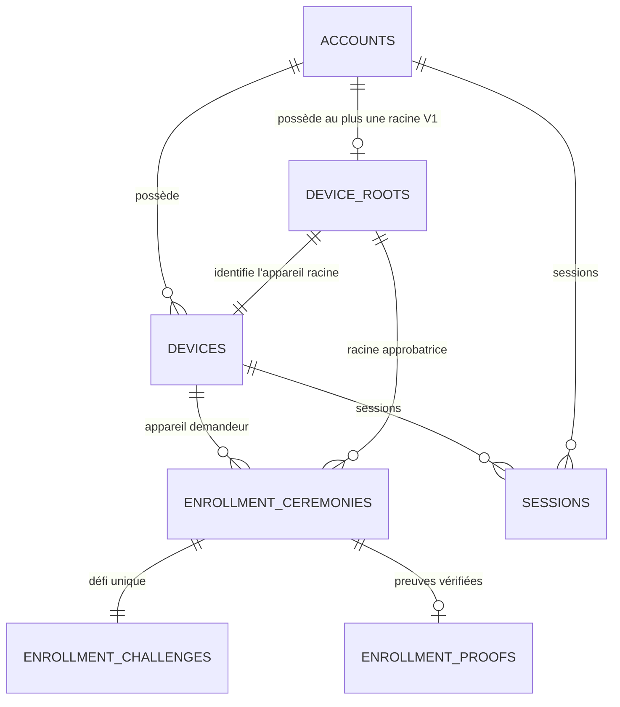

# SAC — Modèle relationnel conceptuel de l'autorité appareil et de l'enrôlement V1

**Date :** 19 novembre 2026  
**Dépôt :** `benwahab/SAC`, branche `main`  
**Statut :** proposition d'architecture pour revue — NON homologuée, NON exécutable.  
**Dépendances :** rapport de compatibilité D1, transcript candidat, consolidation appareils/sessions/récupération et arbitrage d'atomicité D1.

> Ce document décrit les responsabilités et relations nécessaires. Il ne constitue ni une migration SQL, ni une autorisation de créer les tables, ni un protocole cryptographique final. Les noms ci-dessous sont des noms conceptuels provisoires.

## 1. Décisions validées qui contraignent le modèle

- Un compte ne possède qu'un seul appareil racine actif en V1.
- Seule la racine active, non révoquée et correspondant à la génération courante peut approuver un appareil secondaire.
- Le nouvel appareil doit prouver la possession de sa clé privée.
- Les deux preuves portent sur les mêmes octets canoniques, avec des domaines de signature distincts si ce mécanisme est confirmé par la revue cryptographique.
- Un secondaire ne peut ni approuver un autre appareil, ni se promouvoir racine.
- Aucune récupération ou promotion de racine n'est autorisée en V1.
- OTP e-mail, mot de passe, SMS, support et récupération d'accès ne remplacent jamais la preuve cryptographique de la racine.
- Une session est rattachée à un compte et à un appareil précis.
- Inactivité maximale : 30 jours ; durée absolue maximale : 90 jours.
- Un appareil révoqué ne peut ouvrir ni renouveler de session ; les autres appareils du compte ne sont pas révoqués par effet de bord.

## 2. Carte conceptuelle des relations

Le diagramme est logique : les cardinalités et contraintes exactes doivent être traduites en SQL compatible D1/SQLite et prouvées par tests. Une cérémonie peut être refusée ou expirée sans créer d'appareil approuvé.

## 3. Entités conceptuelles

### 3.1 Compte — table existante `accounts`

La table actuelle reste la source du compte et de son état applicatif. Le modèle appareil ne duplique pas le mot de passe, l'e-mail, le téléphone ou l'état du compte.

Référence conceptuelle :
- `account_id` → identifiant réel `accounts.id`.

Règle : toute création de cérémonie et toute activation finale recontrôlent côté serveur que le compte est dans l'état autorisé. Un compte suspendu, supprimé ou en suppression ne peut pas enrôler un appareil.

### 3.2 Registre de racine — `device_roots` (conceptuel)

Une ligne représente l'ancrage cryptographique V1 d'un compte, et non une clé privée.

Attributs conceptuels :
- identifiant interne opaque ;
- `account_id` unique ;
- `root_device_id` ;
- `root_key_version` strictement positive ;
- clé publique d'identité racine, format et stockage à homologuer ;
- empreinte calculée côté serveur selon un profil versionné ;
- état de racine : actif ou révoqué ;
- dates serveur de création et de révocation ;
- identifiant de corrélation/audit non secret.

Contraintes :
- au plus une racine active par compte ;
- la version est monotone, jamais diminuée ni réutilisée ;
- aucune opération V1 ne remplace une racine révoquée ou perdue ;
- une restauration de sauvegarde ne peut pas réactiver une racine révoquée ;
- aucune clé privée n'est stockée dans D1.

**Point à décider avant SQL :** la racine doit-elle être une table indépendante ou une relation 1:1 vers un appareil de `devices` avec contrainte dédiée ? Le choix doit garantir une seule racine active et empêcher les états orphelins. Le diagramme exprime la relation, pas une décision de normalisation.

### 3.3 Registre d'appareils — `devices` (conceptuel)

Une ligne représente un appareil connu du compte, qu'il soit en attente, actif ou révoqué.

Attributs conceptuels :
- `device_id` opaque et non réutilisable ;
- `account_id` ;
- rôle : racine ou secondaire ;
- plateforme : web, android ou ios ;
- libellé utilisateur facultatif, jamais utilisé comme preuve ;
- clé publique d'authentification ;
- clé publique d'accord de clé si cette fonction est confirmée ;
- usages strictement autorisés ;
- empreintes des clés calculées côté serveur ;
- état : pending, active ou revoked ;
- dates serveur de création, activation, dernière activité et révocation ;
- référence de la cérémonie d'activation.

Contraintes :
- un appareil appartient à un seul compte ;
- un appareil révoqué ne redevient jamais actif ;
- un identifiant d'appareil n'est jamais réutilisé ;
- un secondaire ne porte jamais le rôle racine ;
- aucun appareil pending ne reçoit de session protégée ;
- les clés publiques sont validées avant enregistrement ; aucune clé privée ne quitte l'appareil.

La signification et le nom définitif de `agreementPublicKey` doivent être décidés avant le schéma exécutable. Le champ expérimental `exchangePublicKey` et ses usages GPS ne sont pas repris automatiquement.

### 3.4 Cérémonie — `enrollment_ceremonies` (conceptuel)

Une ligne représente une tentative unique d'ajout d'un appareil secondaire.

Attributs conceptuels :
- `ceremony_id` opaque, généré par le serveur ;
- `account_id` ;
- `root_device_id` et `root_key_version` observés à l'ouverture ;
- `new_device_id` réservé côté serveur ;
- plateforme annoncée ;
- état : pending, approved, rejected, expired ou cancelled ;
- version de protocole ;
- empreinte SHA-256 des octets canoniques exacts, une fois le transcript figé ;
- dates serveur d'ouverture, d'expiration et de finalisation ;
- code de motif terminal non sensible ;
- identifiant de corrélation.

Contraintes :
- une cérémonie est liée à un compte, une racine et un nouvel appareil précis ;
- l'identité racine/version observée est immuable dans la cérémonie ;
- une cérémonie terminale ne revient jamais à pending ;
- la création d'une nouvelle tentative ne réactive pas une tentative précédente ;
- le client ne choisit ni le compte, ni la racine, ni les identifiants serveur ;
- l'expiration est décidée par le serveur ; sa durée reste à arbitrer ;
- les données brutes de transport et les secrets ne sont pas journalisés.

Les tentatives concurrentes par compte nécessitent une politique de limitation et d'invalidation à décider. Ne pas supposer qu'une seule cérémonie en attente est imposée avant cet arbitrage.

### 3.5 Défi — `enrollment_challenges` (conceptuel)

Un défi est séparé de la cérémonie afin d'exprimer son usage unique et sa consommation.

Attributs conceptuels :
- identifiant du défi ;
- `ceremony_id` unique ;
- valeur aléatoire serveur de 32 octets, ou représentation protégée/hachée si le protocole retenu le permet ;
- date d'émission et date d'expiration serveur ;
- état : issued, consumed ou expired ;
- date de consommation ;
- référence de la transaction de consommation.

Contraintes :
- défi créé par CSPRNG serveur ;
- lié à une seule cérémonie et donc à un seul compte/racine/nouvel appareil ;
- ne peut être consommé qu'une fois ;
- ne peut être consommé après expiration ;
- aucun OTP email n'est réutilisé ;
- aucune valeur de défi n'apparaît dans les logs.

**Point cryptographique ouvert :** le stockage de la valeur brute ou de son dérivé doit être fixé par le protocole. Si le serveur doit reconstruire les octets signés, il faut conserver les données nécessaires sans affaiblir la protection. Un simple hash du défi ne permet pas de reconstituer le transcript.

### 3.6 Preuves — `enrollment_proofs` (conceptuel)

Cette entité représente les résultats de vérification, pas nécessairement les signatures brutes à conserver.

Attributs conceptuels minimaux :
- `ceremony_id` unique ;
- empreinte des octets canoniques signés ;
- résultat de la preuve de possession du nouvel appareil ;
- résultat de l'approbation par la racine ;
- identifiants/version des clés vérifiées ;
- algorithme et format exacts, une fois homologués ;
- horodatage serveur de chaque vérification ;
- version du validateur.

Règles :
- les deux preuves doivent être valides et porter sur le même transcript canonique ;
- chaque preuve est vérifiée avec la clé publique correspondant au rôle exact ;
- une preuve de racine ne peut pas être utilisée comme preuve du nouvel appareil ;
- les signatures brutes ne sont conservées que si un besoin d'audit explicite et une politique de rétention les justifient ;
- aucune preuve incomplète n'active l'appareil.

Les domaines de signature, ECDSA raw/DER, low-S et l'algorithme final restent soumis à revue indépendante. Le stockage exact des signatures n'est donc pas décidé ici.

### 3.7 Sessions — `sessions` (conceptuel)

Chaque session doit référencer le compte et l'appareil actif qui l'a créée.

Attributs conceptuels :
- identifiant opaque de session ;
- `account_id` ;
- `device_id` ;
- empreinte d'un secret de session/renouvellement, jamais le jeton brut ;
- dates serveur de création, dernière activité, expiration d'inactivité et expiration absolue ;
- date de révocation et motif codé ;
- version de session ou de génération d'autorisation.

Contraintes :
- compte actif, appareil actif et racine/autorité cohérente contrôlés côté serveur ;
- échéance d'inactivité à 30 jours et échéance absolue à 90 jours ;
- révocation appareil invalide toutes les sessions de cet appareil ;
- révocation session ne touche pas les autres appareils ;
- une session révoquée ne peut être renouvelée ;
- chaque requête protégée contrôle l'état courant côté serveur ;
- aucune session n'est créée avant le commit d'activation du nouvel appareil.

**Non décidé :** cookie de session PWA, refresh token, rotation, famille de jetons, stockage Capacitor et mécanisme de renouvellement. Ces choix doivent être faits dans le contrat de session, pas improvisés dans le schéma.

## 4. États et transitions

### Appareil

- `pending` → `active` uniquement après commit atomique de la cérémonie valide.
- `pending` → `revoked` ou état terminal équivalent par annulation/rejet/expiration, selon décision de modélisation.
- `active` → `revoked` par opération autorisée et auditée.
- `revoked` → aucune transition sortante vers active/pending.

Le nom d'un état terminal distinct pour rejet/expiration peut être utile à l'historique de cérémonie, mais l'appareil non activé ne doit pas être considéré comme un appareil approuvé.

### Cérémonie

- `pending` → `approved` seulement après validation des deux preuves et commit ;
- `pending` → `rejected`, `expired` ou `cancelled` selon l'événement autorisé ;
- tout état terminal est irréversible.

Une cérémonie approuvée ne signifie pas que toutes les sessions futures sont autorisées : l'appareil et le compte restent soumis aux contrôles courants.

### Défi

- `issued` → `consumed` une seule fois ;
- `issued` → `expired` après échéance ;
- aucun retour à `issued`.

## 5. Transaction d'activation : ordre logique obligatoire

Le commit final doit être une opération atomique et conditionnelle, pas une succession d'écritures indépendantes.

Préconditions à revalider au point de commit :
1. compte toujours actif ;
2. cérémonie toujours pending et non expirée ;
3. défi toujours issued, non expiré et lié à cette cérémonie ;
4. racine toujours active, non révoquée et même `rootDeviceId` ;
5. `rootKeyVersion` toujours identique ;
6. appareil racine toujours autorisé à approuver ;
7. deux preuves valides sur les mêmes octets canoniques et le même hash ;
8. nouvel appareil toujours réservé à ce compte et non déjà actif/révoqué ;
9. aucun identifiant ou clé déjà lié à un autre appareil.

Effets qui doivent réussir ensemble :
- consommer le défi ;
- finaliser la cérémonie comme approved ;
- activer le nouvel appareil et enregistrer ses clés publiques validées ;
- enregistrer les preuves/résultats nécessaires à l'audit ;
- rendre possible l'ouverture d'une session séparée, après le commit.

Si une précondition échoue, aucun effet partiel ne doit être conservé. La création de session ne doit pas être effectuée avant le commit. La réponse réseau perdue après commit doit pouvoir être reprise sans créer une seconde activation.

**État de la preuve D1 : partiel.** Une expérience isolée dans le runtime Workers local a démontré le rollback d'un `D1.batch()`, la consommation unique sous huit requêtes concurrentes et le rejet d'un défi expiré ou dont le digest ne correspond pas. Voir `docs/ETUDE_ATOMICITE_CHALLENGES_D1_V1.md`. Cette expérience ne couvre pas encore la transaction finale avec les vraies tables account/root/device/ceremony/proof ni la course avec révocation. Il faudra démontrer ces propriétés dans le schéma final. `DB.batch()` seul n'est pas considéré comme preuve suffisante : chaque écriture conditionnelle qui peut toucher zéro ligne doit déclencher un échec dans le même batch.

## 6. Révocation et ordre des opérations concurrentes

La révocation d'un appareil doit invalider ses sessions et ses capacités de renouvellement dans une opération cohérente. Une activation en concurrence avec la révocation de la racine doit échouer si la révocation gagne avant le commit final.

Les tests devront couvrir au minimum :
- deux cérémonies approuvées simultanément pour le même compte ;
- révocation de racine pendant une approbation ;
- révocation du nouvel appareil pendant une finalisation ;
- deux demandes de consommation du même défi ;
- répétition d'une requête après perte de réponse ;
- session créée en concurrence avec révocation ;
- restauration d'un état antérieur à une révocation.

La politique de sérialisation par compte et génération racine doit être définie dans la conception transactionnelle. Ne pas supposer qu'une simple contrainte unique règle toutes les courses.

## 7. Données et rétention

- Aucune clé privée dans D1, R2, logs ou API.
- Aucun jeton de session brut dans D1 ou logs.
- Aucun mot de passe, OTP, challenge brut ou secret dans les logs.
- Limiter les signatures brutes persistées ; préférer résultats vérifiés, empreintes, identifiants de clés et versions de validateur si cela suffit à l'audit.
- Les données de cérémonie ont une durée de conservation à définir : conserver l'état nécessaire à l'anti-rejeu et à la traçabilité sans conserver indéfiniment les matériaux cryptographiques.
- Les journaux d'audit doivent exclure les secrets et suivre une politique de rétention séparée.
- Aucun GPS n'est inclus dans ce modèle ; le GPS reste NO-GO jusqu'à preuve des suppressions immédiates et J+30 irréversibles.

## 8. Questions à fermer avant schéma SQL

| Sujet | Décision requise | Bloquant |
|---|---|---|
| Représentation racine/appareil | Table racine indépendante ou relation 1:1 contrainte | Oui |
| Une seule cérémonie pending | Autoriser plusieurs demandes concurrentes ou imposer une seule par compte | Oui |
| Expiration et quotas | TTL, limites de tentatives et de cérémonies | Oui |
| Défi | Stockage brut protégé ou autre représentation compatible avec la reconstruction signée | Oui |
| Transcript | Homologuer JCS, les limites et le profil JWK | Oui |
| Clé d'accord | Nom, usage, nécessité réelle et cycle de vie | Oui |
| Signatures | ECDSA, raw/DER, low-S, domaines définitifs | Oui |
| SAS | Algorithme, entropie, affichage, comparaison et erreurs | Oui |
| Certificat durable | Besoin, format, durée et révocation | Oui |
| Session | Cookie/jeton, renouvellement, rotation et révocation | Oui |
| Audit | Événements, intégrité, accès et rétention | Oui |
| D1 atomicité | Stratégie de transaction et preuve de rollback/concurrence | Oui |

## 9. Séquence de réalisation après homologation

1. Faire relire ce modèle conceptuel et le transcript par une revue indépendante sécurité/cryptographie.
2. Fermer les questions bloquantes, sans transformer les valeurs de travail en décisions par défaut.
3. Produire un schéma relationnel logique final avec contraintes SQLite précises.
4. Écrire une migration isolée et des tests D1 de contraintes, transitions et atomicité.
5. Implémenter les validateurs cryptographiques indépendants du transport.
6. Implémenter les endpoints de cérémonie et leur authentification serveur.
7. Implémenter activation, révocation et sessions liées aux appareils.
8. Tester Web, Android et iOS sur appareils réels et en réseau interrompu.
9. Faire une revue indépendante finale avant toute activation en environnement réel.

## 10. Verdict

Le modèle relationnel conceptuel est désormais décrit, mais il ne lève aucun NO-GO. Les tables et noms sont provisoires, les décisions ouvertes restent ouvertes, et aucune migration/API/session n'est créée par ce document.

**Prochaine étape logique :** revue critique du modèle et fermeture des questions bloquantes, puis seulement rédaction du schéma SQL final. La racine unique et l'interdiction de récupération/remplacement de racine en V1 restent inchangées.

## 11. Complément — arbitrages techniques proposés

Le document [ARBITRAGES_TECHNIQUES_ENROLEMENT_APPAREILS_V1.md](ARBITRAGES_TECHNIQUES_ENROLEMENT_APPAREILS_V1.md) consolide les recommandations sur la normalisation racine/appareil, les cérémonies concurrentes, le nonce et le transcript, les TTL, SimpleWebAuthn, la transaction D1, les sessions et l'audit.

Il ajoute un point bloquant : D1 Time Travel peut restaurer un état antérieur et donc réintroduire dans D1 un état précédant une révocation. Une stratégie anti-retour-arrière indépendante ou une procédure de restauration fail-closed doit être conçue et testée avant la production. Ce complément ne valide aucun arbitrage et ne lève aucun NO-GO.
